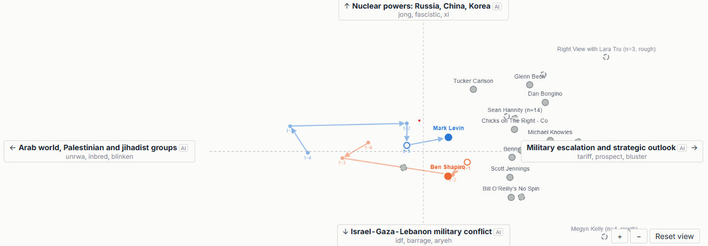
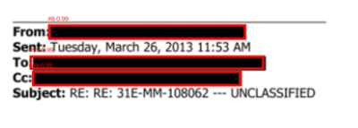
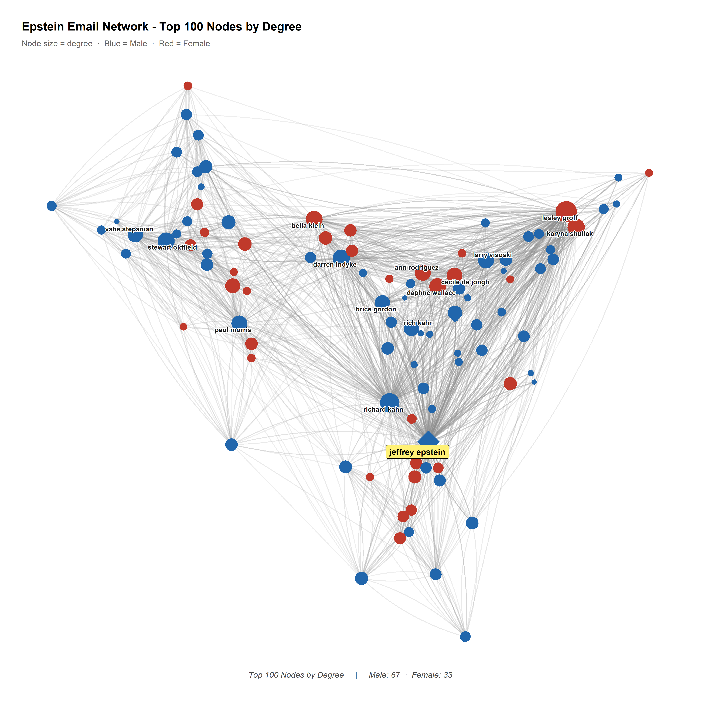

# Academic Projects

## Project 1: Political Podcast Text Analysis

{fig-align="center"}

Over the past decade, podcasts have become a major channel for political and cultural conversation, with shows across the spectrum building large audiences, often with strong parasocial ties to their hosts. I wanted to see how different shows and ideological groups talk about the same topics, focusing on the vocabulary a show uses rather than the stance it takes. Following that vocabulary over time gives an empirical picture of what the political podcast world is discussing and how.

I built the whole pipeline myself. I transcribed more than 80,000 episodes from about 60 shows, going back to March 2021, with Whisper on the UMass Unity GPU cluster. For a chosen term such as *iran*, *israel* or *trump*, I collect the nouns, names and adjectives around each mention. From those I build an à la carte embedding (Rodriguez, Spirling and Stewart 2023) for each show in each period, so every point on the map comes only from how that show used the word. Shows with few episodes look different partly by chance, so the distances between shows are corrected for that. Each distance also comes with a bootstrapped 90% interval.

The method changed a lot as I went. I started with TF-IDF word lists and word2vec similarity, then moved to BERT sentence embeddings, clustering the contexts around each term and testing for change over time. The clusters were often readable, but they tracked which stories a show was covering more than how it talked about them, and the change-over-time tests never gave results I trusted. À la carte embeddings fixed both problems. They gave one comparable point per show per period, and the uncertainty could be measured directly.

The results are in an interactive dashboard. You can see where the shows sit in a given period and how each one moves over time. You can also compare the words that separate two shows and read the passages they come from. An LLM drafts the labels on the map's axes from the words at each end. The labels are marked as AI and shown next to those words, so readers can judge them for themselves.

A lot of what I learned was about communicating results. A position on the map reflects shared vocabulary, and a small gap between two shows may be noise. Readers need to know both of those things before the numbers are any use. I went through several rounds of feedback from people without a technical background and from outside design reviews. Each round changed the layout or the wording. Eventually I added a switch between plain and technical explanations, so the same page works for a general reader and for someone checking the methods. Results are labelled "clear difference" or "inconclusive" instead of reporting p-values, and every number is shown with its range.

The project began in DACSS 758 (Text as Data) and I've kept building on it since.

[Live dashboard](https://boazalkalay.github.io/podcast-term-map/) · [GitHub](https://github.com/BoazAlkalay/podcast-term-map)
<!-- Add once the Data Viz walkthrough is written:  · [Walkthrough and in-depth example](data-viz.qmd) -->

## Project 2: Epstein Email Network

::: {layout-ncol=2}
{fig-align="center"}

{fig-align="center"}
:::

The Department of Justice's release of the Epstein email records offers a rare chance to observe an elite communication network directly rather than through court testimony or journalistic reconstruction. With two collaborators, I built a Python pipeline that extracts headers from roughly 1.4 million released email records — classifying pages with dual OCR engines, locating redactions with a fine-tuned Mask R-CNN, and recovering sender and recipient fields — then resolved names in R through a six-pass matching pipeline into a longitudinal directed network of 990 confirmed individuals across 21 yearly waves (2000–2020), totaling 6,250 unique communication ties.

The network is modeled with Bootstrapped Temporal Exponential Random Graph Models (BTERGM) to test two hypotheses drawn from the literature on brokerage and gendered social capital:

- **H1:** Actors in structural brokerage positions (low lagged Burt's constraint) are disproportionately active in tie formation.
- **H2:** Ties form disproportionately between individuals of the same sex.

Both hypotheses are supported. Low-constraint brokers are significantly more likely to send and receive ties, and same-sex dyads are 15.7% more likely to form than mixed-sex dyads, net of reciprocity, transitivity, and tie persistence. A secondary finding shows an asymmetric sex pattern: women are significantly more likely to initiate ties, while men are significantly more likely to receive them — women disproportionately write, men are disproportionately written to. A follow-up beta regression on Burt's constraint (restricted to nodes with actual brokerage opportunity) finds women occupy significantly more broker-like positions than men, net of year fixed effects.

A time series extension separately models monthly redaction density with `auto.arima()`. The aggregate series shows a clear upward drift trend — which disappears when emails not directly involving Epstein are modeled alone, suggesting the drift tracks his centrality specifically rather than a general feature of the corpus. Redaction density also carries a stable gender pattern: F→F communications are the most heavily redacted, concentrated almost entirely among non-Epstein actors.

This work was completed in collaboration with Mark Scott and Elizabeth Miller, and won Best Master's Project at the computational social science fair.

[Data visualizations & full results](data-viz.qmd) · [GitHub](https://github.com/BoazAlkalay)

# Personal Projects

## Project 3: Noble House & NPC Relationship Map for D&D

In one of my classes, we worked with a well-known dataset: the noble houses of Renaissance Florence and the marriages that connected them. The D&D campaign I've been running draws heavily on that same period, and the overlap was hard to ignore — it seemed like a natural excuse to practice social network analysis on something I actually cared about. I built the first version of this project as a Quarto document over winter break, and that's also when I first got excited about the tidygraph and visNetwork ecosystem in R.

Around the same time, I'd been hoping to bring ERGMs — a statistical modeling approach for networks — into some of my other coursework and projects. That didn't pan out: statnet, the package that actually runs them, doesn't work well with tidygraph/igraph objects, and that disappointment ended up bleeding into my enthusiasm here too, since it was riding the same wave of excitement. This project also had its own separate barrier — building out enough houses and NPCs by hand to make the graph worth looking at required a lot of tedious world-building before there was anything interesting to see. Between the two, momentum stalled out over the winter.

What got it moving again was converting the whole thing into a Shiny app, with random name and seed-data generation built in — which solved the world-building barrier directly, and finally made this something worth showing to friends or anyone curious enough to build their own noble house drama.

The Florentine network we studied in class only modeled relationships between the houses themselves. I wanted to go further: a two-mode network that also captures the NPCs, the relationships between individuals, and the ties connecting people to the institutions that shape their lives.

A lot of this could also be handled in Obsidian, which I'm a big proponent of — but the lessons learned and the fun of building it were worth the detour on their own.

Next up: easier ways to bring in existing tables for personality traits, bonds, and flaws, plus homebrew rolling tables for house-level attributes like wealth and industry.

<iframe src="faction-graph-demo.html" width="100%" height="550" style="border:none;"></iframe>

**What it does**
- Add houses and NPCs, wire up relationships between them
- Relationship types auto-filter based on what's actually valid between the two entities you pick
- Edit, delete, and reorganize as the campaign evolves

**Built with:** R, Shiny, `tidygraph`/`igraph`, `visNetwork`, `bslib`

[Live demo](https://boazalkalay.shinyapps.io/faction-relationship-graph/) · [GitHub](https://github.com/boazalkalay/faction-relationship-graph)